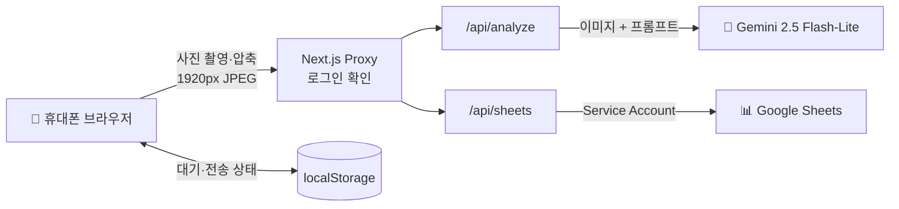

# 🧾 ReceiptLens

> 영수증을 찍으면 AI가 읽고, Google Sheets 장부에 알아서 적어주는 개인용 회계 웹앱

<br>

## 📌 프로젝트 소개

**ReceiptLens**는 종이 영수증을 손으로 장부에 옮겨 적는 수고를 없애기 위해 만든 웹앱입니다.
휴대폰으로 영수증을 찍으면 **Gemini Vision AI**가 날짜·상호·금액을 읽고, 확인 버튼 한 번으로 **Google Sheets 월별 장부**에 기록합니다.

**핵심 기능**
1. 📸 **영수증 촬영 → AI 자동 인식**
   - 날짜, 상호명, 공급가액, 부가세, 합계를 추출
   - 날짜가 없으면 오늘 날짜, 공급가액·부가세가 없으면 합계로 자동 계산
2. 📊 **Google Sheets 월별 장부 자동 기록**
   - `YYYY.MM` 시트를 자동 생성하고, 정산(합계)·잔액 행이 항상 최신으로 유지

그 외에 여러 장 한 번에 촬영, 일괄 전송, 전송 전 수정, 중복 전송 방지 기능이 있습니다.

<br>

## 🏗️ 시스템 아키텍처



- **프론트엔드와 서버를 하나로**: Next.js App Router의 Route Handler가 API 서버 역할을 합니다.
- **비밀값은 서버에만**: Gemini 키와 서비스 계정 키는 서버에서만 쓰고, 브라우저 번들에는 들어가지 않습니다.
- **DB 없음**: 장부는 Google Sheets, 대기 목록은 브라우저 localStorage에 저장합니다.

<br>

## 📊 장부 구조 (Google Sheets)

영수증 날짜 기준으로 `2026.11` 같은 월별 시트가 자동으로 만들어집니다.

| 행 | A | B | C | D | E | F | G | H | I |
|---|---|---|---|---|---|---|---|---|---|
| 1 | **수입** | | | **지출** | | | | | |
| 2 | 날짜 | 항목 | 운영비 | UUID | 일자 | 상호명 | 항목 | 메모 | 합계 |
| 3~ | ✍️ 직접 입력 | | | 🤖 앱 자동 입력 | | | | | |
| N | **정산** | | `=SUM(…)` | | | | | | `=SUM(…)` |
| N+1 | **잔액** | | `=수입-지출` | | | | | | |

- 새 영수증은 **정산 행 바로 위**에 끼워 넣어서, 합계 수식이 자동으로 따라옵니다.
- 정산 수식은 `=SUM(I$2:INDEX(I:I,ROW()-1))`라서, 행이 늘어나도 다시 쓸 필요가 없습니다.

<br>

## ⚙️ 주요 기능

### 🎯 핵심 기능
| 기능 | 설명 |
|---|---|
| 📸 영수증 인식 | 카메라 촬영 또는 파일 선택(최대 5장) → AI가 5개 항목 추출 |
| ✏️ 전송 전 수정 | 인식 결과를 확인하고 날짜·상호·금액·항목·메모 수정 |
| 📤 시트 전송 | 한 장씩 또는 전체 일괄 전송 |
| 🛡️ 중복 방지 | 같은 영수증(UUID)은 두 번 기록되지 않음 |

### 📱 부가 기능
| 기능 | 설명 |
|---|---|
| 📋 대시보드 | 총 지출, 전송 건수, 대기 건수, 오늘 사용 횟수 |
| ⏳ 대기 영수증 | 전송 안 한 영수증을 나중에 승인·전송 |
| 🔁 기록 수정 | 이미 보낸 영수증을 시트에서 바로 수정 |
| 👀 시트 미리보기 | 오늘 기록된 행을 앱에서 바로 확인 |
| 🔢 사용 한도 | 하루 30회 분석 제한 (무료 한도 보호) |

<br>

## 🔒 보안

| 항목 | 적용 내용 |
|---|---|
| 로그인 | 비밀번호 로그인 + `HttpOnly`·`SameSite=Lax` 세션 쿠키 (서버에서 30일 만료 검사) |
| CSRF | SameSite 쿠키 + Origin 헤더 검사 |
| 수식 인젝션 | 시트에 쓰는 문자열이 `=`, `+`, `-`, `@`로 시작하면 텍스트로 저장 |
| 입력 검증 | 이미지 형식·5MB 제한, 날짜·UUID·글자 수 검증 (Zod) |
| 비밀값 격리 | API 키는 서버 환경변수에만, 에러 원문은 클라이언트에 노출 안 함 |

<br>

## 💻 기술 스택

### 🎨 Frontend


### 🛠 Backend


### 🤖 AI


### 🗄 Storage


### ☁️ Deploy


### 🔗 Version Control


<br>

## 💰 비용 0원 원칙

| 서비스 | 사용 방식 | 비용 |
|---|---|---|
| Gemini API | 무료 등급 (결제 계정 연결 안 함) | 0원 |
| Google Sheets API | 서비스 계정 | 0원 |
| Vercel | Hobby 플랜 | 0원 |
| DB·스토리지 | 사용 안 함 | 0원 |

> ⚠️ Gemini 프로젝트에 결제 계정을 연결하면 선불(Prepay) 방식으로 바뀌고, 크레딧이 0이 되면 `402 Payment Required`로 멈춥니다. 결제 계정 연결을 해제하면 무료 등급으로 돌아갑니다.

<br>

## 🚀 실행 방법

```bash
npm install
cp .env.example .env.local   # 값 채우기 (아래 표 참고)
npm run dev                  # http://localhost:3000
```

| 명령 | 설명 |
|---|---|
| `npm run dev` | 개발 서버 |
| `npm test` | 핵심 로직 테스트 |
| `npx tsc --noEmit` | 타입 체크 |
| `npm run build` | 프로덕션 빌드 |

### 🔑 환경변수 (`.env.local`)
| 변수 | 설명 |
|---|---|
| `GEMINI_API_KEY` | [Google AI Studio](https://aistudio.google.com/apikey)에서 발급 (결제 연결 안 된 프로젝트) |
| `GOOGLE_SPREADSHEET_ID` | 스프레드시트 URL의 `/d/` 뒤 문자열 |
| `GOOGLE_SERVICE_ACCOUNT_KEY` | 서비스 계정 JSON 키를 **한 줄로** 넣은 값 |
| `APP_PASSWORD` | 앱 로그인 비밀번호 (8자 이상, 없으면 전체 차단) |
| `NEXT_PUBLIC_GOOGLE_SHEET_URL` | (선택) 대시보드의 시트 바로가기 링크 |

Vercel에 배포할 때는 **Settings → Environment Variables**에 같은 값을 넣습니다.

### ☁️ Google 설정
1. **서비스 계정 만들기**: Google Cloud Console → IAM 및 관리자 → 서비스 계정 → 만들기 → 키 탭에서 JSON 키 다운로드
2. **JSON 키를 한 줄로 복사**
   ```powershell
   (Get-Content 키파일.json -Raw) -replace "`r`n|`n", "" | Set-Clipboard
   ```
3. **시트 공유**: Google Sheets → 공유 → 서비스 계정 이메일(`…@….iam.gserviceaccount.com`)을 **편집자**로 추가
4. 키 파일은 `.env.local`에 넣은 뒤 **삭제**합니다. (`*.json`은 git에 올라가지 않도록 막혀 있습니다)

<br>

## 📁 폴더 구조

```
├── app/
│   ├── api/
│   │   ├── analyze/     # 영수증 이미지 → Gemini 분석
│   │   ├── sheets/      # 시트 조회·추가·수정
│   │   └── auth/        # 로그인·로그아웃
│   ├── scanner/         # 촬영·분석·전송 화면
│   ├── login/           # 로그인 화면
│   └── page.tsx         # 대시보드
├── components/          # dashboard / scanner / ui
├── hooks/               # useReceipts(전송·저장), useDailyCount, useToast
├── lib/                 # 서버 전용: gemini, google-sheets, auth, validators
├── tests/               # node --test 테스트
└── proxy.ts             # 모든 요청 로그인 확인
```

<br>

## 👤 개발자

| 이름 | 역할 | GitHub |
|---|---|---|
| seojin | 기획 · 개발 · 배포 | [@seojointly](https://github.com/seojointly) |
